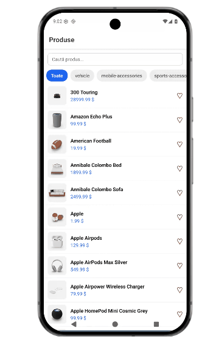
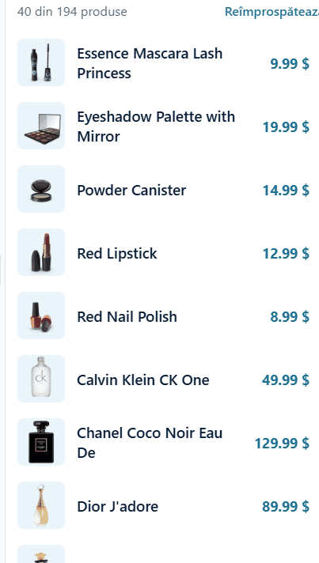
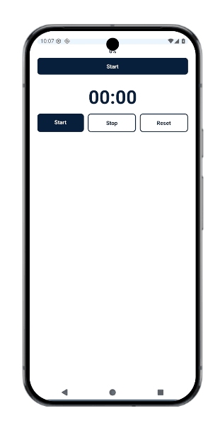
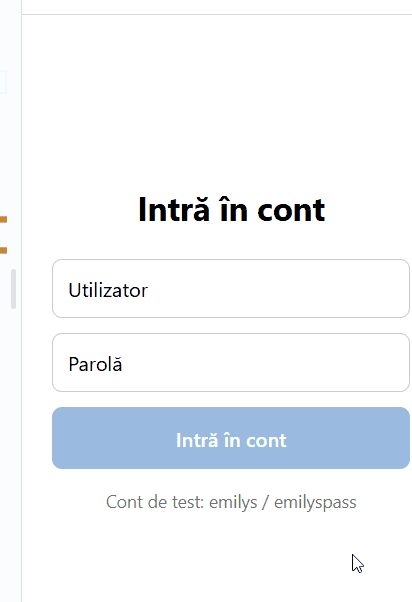
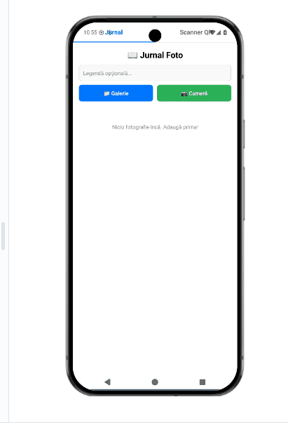
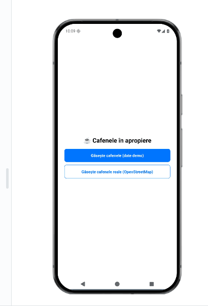
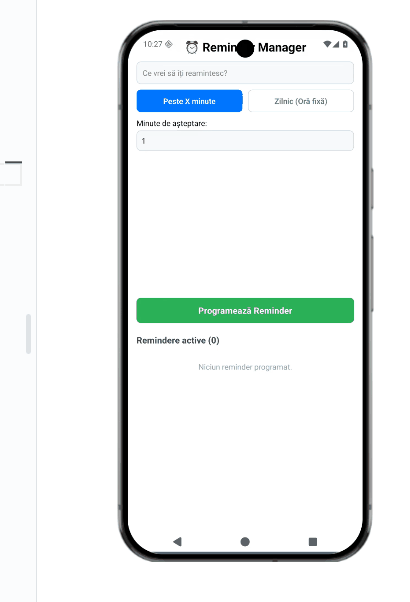
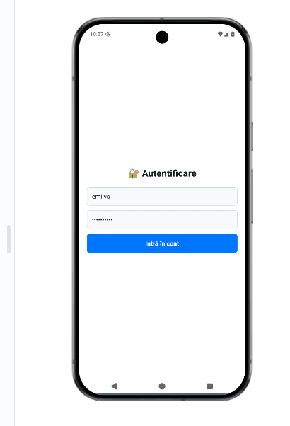
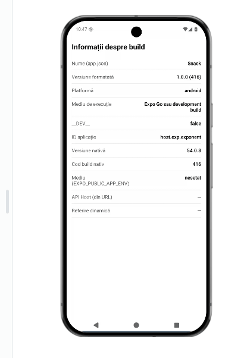

# Portofoliu de Laborator – Dezvoltarea Aplicațiilor Mobile

- **Studentă:** Oșurco Iulia  
- **Grupa:** IT2401  
- **Instituția:** Universitatea Tehnica a Moldovei.Centrul Universitar "Bogdan Petriceicu Hasdeu” din Cahul  

Bun venit în portofoliul meu digital! Această pagină conține lucrările de laborator realizate în cadrul disciplinei.

---

## Laboratorul 4: [Titlul Lucrării / Scurtă descriere]
- **Descriere:** Implementarea componentelor de bază și gestionarea stării în aplicații mobile.
- **Fișiere și Cod:** [Vezi folderul laboratorului 4]([https://github.com/juliaoshurco07-debug/juliaoshurco07.github.io/tree/main/lab4](https://github.com/juliaoshurco07-debug/juliaoshurco07.github.io/tree/main/lab4))
- **Link util:** [https://snack.expo.dev/@julia7/lab4](https://snack.expo.dev/@julia7/lab4)
- **Demonstrație Video (GIF):**  

  

---

## Laboratorul 5.1: [Titlul primei părți]
- **Descriere:** [Scurtă descriere pentru partea 5.1]
- **Fișiere și Cod:** [Vezi folderul laboratorului 5.1](https://github.com/juliaoshurco07-debug/juliaoshurco07.github.io/tree/main/lab5_s1)
- **Link util:** [https://snack.expo.dev/@julia7/lab5_1](https://snack.expo.dev/@julia7/lab5_1)
- **Demonstrație Video (GIF):**  

  

---

## Laboratorul 5.2: [Titlul celei de-a doua părți]
- **Descriere:** [Scurtă descriere pentru partea 5.2]
- **Fișiere și Cod:** [Vezi folderul laboratorului 5.2](https://github.com/juliaoshurco07-debug/juliaoshurco07.github.io/tree/main/lab5_2)
- **Link util:** [https://snack.expo.dev/@julia7/lab5_2](https://snack.expo.dev/@julia7/lab5_2)
- **Demonstrație Video (GIF):**  

  

---

## Laboratorul 6: [Titlul Lucrării / Scurtă descriere]
- **Descriere:** Integrarea serviciilor externe, API-uri și preluarea datelor în timp real.
- **Fișiere și Cod:** [Vezi folderul laboratorului 6](https://github.com/juliaoshurco07-debug/juliaoshurco07.github.io/tree/main/lab6)
- **Demonstrație Video (GIF):**  

  

---

## Laboratorul 7: [Titlul Lucrării / Scurtă descriere]
- **Descriere:** Gestionarea stocării locale a datelor pe dispozitivul mobil.
- **Fișiere și Cod:** [Vezi folderul laboratorului 7](https://github.com/juliaoshurco07-debug/juliaoshurco07.github.io/tree/main/lab7)
- **Demonstrație Video (GIF):**  

  

---

## Laboratorul 8: [Titlul Lucrării / Scurtă descriere]
- **Descriere:** Utilizarea elementelor native ale dispozitivului (cameră, senzori, locație).
- **Fișiere și Cod:** [Vezi folderul laboratorului 8](https://github.com/juliaoshurco07-debug/juliaoshurco07.github.io/tree/main/lab8)
- **Demonstrație Video (GIF):**  

  

---

## Laboratorul 9: [Titlul Lucrării / Scurtă descriere]
- **Descriere:** Optimizarea performanței și animații în interfețele mobile.
- **Fișiere și Cod:** [Vezi folderul laboratorului 9](https://github.com/juliaoshurco07-debug/juliaoshurco07.github.io/tree/main/lab9)
- **Demonstrație Video (GIF):**  

  

---

## Laboratorul 10: [Titlul Lucrării / Scurtă descriere]
- **Descriere:** Testarea aplicațiilor mobile și depanarea erorilor.
- **Fișiere și Cod:** [Vezi folderul laboratorului 10](https://github.com/juliaoshurco07-debug/juliaoshurco07.github.io/tree/main/lab10)
- **Demonstrație Video (GIF):**  

  

---

## Laboratorul 11: [Titlul Lucrării / Scurtă descriere]
- **Descriere:** Proiectul final de laborator / Integrare complexă.
- **Fișiere și Cod:** [Vezi folderul laboratorului 11](https://github.com/juliaoshurco07-debug/juliaoshurco07.github.io/tree/main/lab11)
- **Demonstrație Video (GIF):**  

  

---

## Tehnologii Utilizate
- **Framework-uri & Limbaje:** React Native, Expo, JavaScript, Python
- **Instrumente:** Git, GitHub Pages, VS Code

---
© 2026 - Oșurco Iulia | Grupa IT2401
